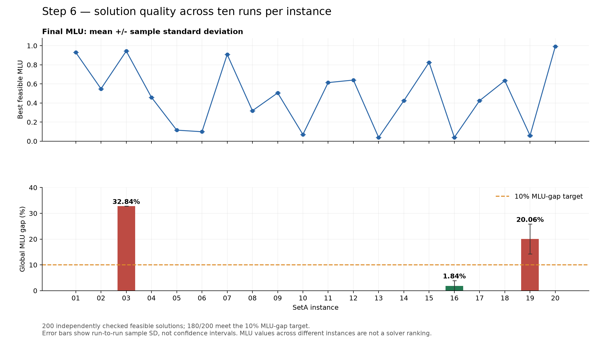
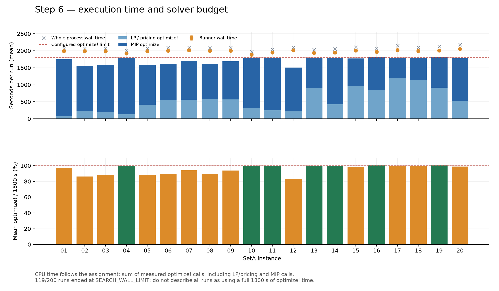
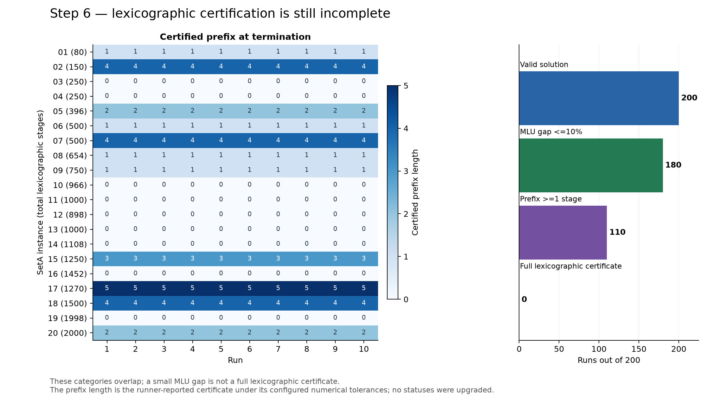
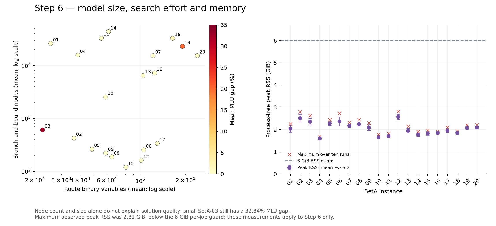

# Step 6 — SetA time-0 experimental results

## Main findings

All **200 runs** are present: twenty original SetA instances, ten runs each, seeds 1001–1010. Every saved route was independently reconstructed from the original network, traffic and scenario JSON files using next-hop ECMP. All 200 solutions satisfy the checked route, MaxSeg and load conditions; the maximum discrepancy in normalized physical-arc loads is **0**. No solver was started for this analysis.

**180/200 runs (90%)**, covering all ten runs of **18/20 instances**, meet the selected MLU gap target of 10%. All ten SetA-03 runs fail the target; all ten SetA-19 runs fail it. Every run is correctly retained as **Not Optimal** with respect to the full lexicographic objective. There are no full lexicographic certificates. A certified prefix of at least one stage is reported for 110 runs; 90 report zero stages.

This is a useful feasible-solution dataset, with two limitations that must be stated in a submission: the MLU target is not met universally, and the configured time limit did not translate to 1800 seconds of optimize! work in every run.

## Experiment and provenance

- Model: time 0 only, original SetA data, no time-1 Budget constraint; lexicographically sorted physical-arc loads.
- Solver: HiGHS 1.15.1; one solver thread per job; six parallel workers on one e2-highmem-8 VM (8 vCPU, 64 GiB RAM).
- Formulation: route columns, ECMP; configured optimize! budget 1800 seconds per run, nominal 10% MLU reporting target, proof and lock tolerances 1e-7.
- Source: `/opt/orange/results/step6_tenrun_20261022` on `orange-step6-worker`.
- Canonical data: each job's exact `setA-NN_run-RR.json`, solution JSON and supervisor JSON. Aggregation keys are `(instance, run)`, with exactly runs 1–10 required for each instance.
- The supplied `step6_runs.csv` is **not** used as the analysis input. It has **53,987 rows**, because the old collector mixed per-stage event JSON files into the result records. At final aggregation this also caused `TypeError: '<' not supported between instances of 'NoneType' and 'str'`. This explains the systemd service's failed status; it does not indicate failed solver runs. `runs_clean.csv` is rebuilt from the 200 canonical result files.

## What the objective and gap mean

For normalized arc loads sorted in nonincreasing order, the original objective is

\[ \min_{\mathrm{lex}} (\ell_{(1)},\ell_{(2)},\ldots,\ell_{(|A|)}). \]

The scalar MLU shown in the table is only the first component, `objective = ell_(1)`. The per-run global MLU gap is

\[g_k=\max(0,1-LB_k/UB_k).\]

An instance's table entry is `mean(g_k)` over its ten runs. It is not `1 - mean(LB)/mean(UB)`. A 10% MLU gap does not prove the remaining components optimal. Certified stages are kept exactly as reported by the runner, including its numerical tolerances; a tiny displayed gap is never used to upgrade a status or prefix.

For each metric x, ten-run summary statistics use

\[\bar x=\frac1{10}\sum_{k=1}^{10}x_k,\qquad s_x=\sqrt{\frac1{9}\sum_{k=1}^{10}(x_k-\bar x)^2}.\]

The error bars and ± values are sample standard deviations, not confidence intervals.

## Quality and stability

- **SetA-03:** mean MLU **0.943543**, gap **32.8424% ± approximately 0**. The incumbent MLU is identical across seeds. Repeating the same setup ten times gives stable output but does not close the proof gap. The available records alone cannot separate a weak lower bound from an incumbent that could improve substantially.
- **SetA-19:** mean MLU **0.0588759 ± 0.00436070**, mean gap **20.0585% ± 5.81997 percentage points**. Individual gaps range from **10.7143% to 28.5715%**, so no run reaches the 10% target. Its incumbent MLU coefficient of variation is **7.41%**, making seed sensitivity material here.
- **SetA-16:** all runs meet the target; mean gap **1.8435% ± 2.1040 percentage points**. MLU coefficient of variation is **2.21%**. This is smaller variability than SetA-19, but still visible.
- Sixteen instances have MLU sample SD below 1e-9; SetA-10 and SetA-14 have only small absolute numerical differences. Stable MLU does not imply identical route vectors or full lexicographic optimality.
- An MLU near one means the busiest physical arc is nearly fully utilized. It does not mean the routing algorithm performed poorly relative to another instance: traffic, capacity and topology differ between instances.

## Time-budget caveat

The assignment asks to measure the execution time of optimize! calls. The canonical field is `cpu_time_seconds`, which in this implementation sums elapsed durations of the measured optimize! calls, including LP/pricing and MIP solves. It is not total process wall time and is not an operating-system CPU accounting measurement.

- Mean optimize! time: **1715.65 seconds** (**28.59 minutes**).
- Mean runner wall time: **1982.50 seconds**; mean entire-process wall time: **2079.90 seconds**. The wrapper's whole-process measurement additionally includes startup/compilation overhead.
- Total optimize! work: **95.31 hours**, versus **115.55 summed process-hours**; parallel process-hours must not be interpreted as elapsed campaign duration.
- **81 TIME_LIMIT runs:** optimize! time 1800.01–1810.00 seconds, including small solver/callback overshoot.
- **119 SEARCH_WALL_LIMIT runs:** optimize! time 1474.24–1799.81 seconds, mean 1657.56 seconds. They stopped because of the runner's search-wall guard before reaching the full optimize! budget.
- Across all runs, measured optimize! time averages **95.31%** of the nominal 1800-second budget. LP/pricing accounts for **31.94%** of optimize! time, and MIP for the remainder.

Consequently, this report must not claim that every run spent a full 30 minutes inside optimize!. For strict equal-budget comparisons or a requirement to consume the full optimize! allowance, the wall-guard policy needs correction and affected runs need a separately authorized rerun. No reruns or source-model changes were made during this analysis.

## Lexicographic progress

The certified prefix ranges from **0 to 5 stages**; none reaches the full vector (80–2000 components depending on the instance). The mean certified fraction is **0.335%**, but this is a count of certified components, not a percentage of numerical accuracy or remaining computational effort. Stage difficulty is unequal, so it cannot be extrapolated linearly to an optimality ETA.

Small global MLU gaps coexist with zero or short reported prefixes. The table distinguishes feasible solution quality, the first-component gap and the stronger full lexicographic certificate. The `Not Optimal` classification is therefore correct even for instances whose displayed MLU gap rounds to zero.

## Search effort and memory

The average route-binary count ranges from approximately **22,448** (SetA-03) to **238,918** (SetA-20). The small SetA-03 still has a 32.84% gap, whereas SetA-20's MLU gap is negligible. Size or B&B node count alone is therefore not a reliable difficulty predictor. Node counts are reported as measured, without converting them into an unsupported percentage of the search tree pruned.

The maximum observed process-tree RSS over all 200 runs is **2.813 GiB**, below the 6 GiB per-job guard. Average observed peak RSS is **2.049 GiB**. There are no recorded memory-guard failures in this Step 6 dataset. This supports the six-worker setting for these Step 6 runs; it does not justify applying the same memory assumption to the different Step 9 model.

## Numerical table

| Instance | V | A | D | MLU mean ± SD | optimize! s mean ± SD | Gap % mean ± SD | B&B nodes mean ± SD | Certified stages | Status |
|---|---:|---:|---:|---:|---:|---:|---:|---:|---|
| setA-01 | 20 | 80 | 40 | 0.929384 ± 0 | 1743.82 ± 6.69 | 4.152e-06 ± 0 | 26076.6 ± 4.42e+03 | 1/80 | Not Optimal (10/10) |
| setA-02 | 30 | 150 | 45 | 0.548578 ± 0 | 1550.01 ± 12.8 | 5.6458e-06 ± 0 | 424.6 ± 21.2 | 4/150 | Not Optimal (10/10) |
| setA-03 | 50 | 250 | 20 | 0.943543 ± 0 | 1579.33 ± 19.1 | 32.842 ± 3.39e-13 | 606.8 ± 61.7 | 0/250 | Not Optimal (10/10) |
| setA-04 | 50 | 250 | 200 | 0.459119 ± 0 | 1800.14 ± 0.104 | 3.1781e-05 ± 3.93e-14 | 15721 ± 3.65e+03 | 0/250 | Not Optimal (10/10) |
| setA-05 | 100 | 396 | 100 | 0.115524 ± 0 | 1580.01 ± 12.8 | 0 ± 0 | 262.2 ± 10.7 | 2/396 | Not Optimal (10/10) |
| setA-06 | 100 | 500 | 500 | 0.0985916 ± 1.09e-17 | 1610.21 ± 21.6 | 1.0143e-05 ± 1.4e-14 | 254.3 ± 51.8 | 1/500 | Not Optimal (10/10) |
| setA-07 | 100 | 500 | 800 | 0.907989 ± 0 | 1692.09 ± 22.7 | 4.2027e-06 ± 0 | 15325.2 ± 1.18e+03 | 4/500 | Not Optimal (10/10) |
| setA-08 | 150 | 654 | 200 | 0.318904 ± 0 | 1616.73 ± 30.2 | 2.2204e-14 ± 0 | 187.5 ± 5.64 | 1/654 | Not Optimal (10/10) |
| setA-09 | 150 | 750 | 200 | 0.505384 ± 0 | 1688.38 ± 27.7 | 5.9574e-06 ± 0 | 221.1 ± 45.9 | 1/750 | Not Optimal (10/10) |
| setA-10 | 150 | 966 | 1000 | 0.0695652 ± 8.5e-09 | 1800.21 ± 0.131 | 0.000171 ± 3.16e-05 | 2532.9 ± 613 | 0/966 | Not Optimal (10/10) |
| setA-11 | 200 | 1000 | 400 | 0.613544 ± 0 | 1800.46 ± 0.565 | 2.6299e-05 ± 9.02e-14 | 32829.8 ± 4.18e+03 | 0/1000 | Not Optimal (10/10) |
| setA-12 | 200 | 898 | 400 | 0.640075 ± 0 | 1502.76 ± 17 | 2.5623e-05 ± 1.67e-14 | 160.6 ± 7.37 | 0/898 | Not Optimal (10/10) |
| setA-13 | 200 | 1000 | 2000 | 0.0388889 ± 1.23e-17 | 1800.71 ± 0.593 | 0.00026714 ± 3.13e-14 | 6458.2 ± 1.67e+03 | 0/1000 | Not Optimal (10/10) |
| setA-14 | 250 | 1108 | 600 | 0.423969 ± 1.34e-06 | 1800.11 ± 0.148 | 0.00039966 ± 0.000315 | 43667.7 ± 1.02e+04 | 0/1108 | Not Optimal (10/10) |
| setA-15 | 250 | 1250 | 600 | 0.825206 ± 0 | 1774.09 ± 19.3 | 1.1102e-14 ± 0 | 119.2 ± 12.7 | 3/1250 | Not Optimal (10/10) |
| setA-16 | 250 | 1452 | 4800 | 0.0396824 ± 0.000876 | 1803.47 ± 3.39 | 1.8435 ± 2.1 | 32769.7 ± 8.87e+03 | 0/1452 | Not Optimal (10/10) |
| setA-17 | 300 | 1270 | 2000 | 0.424192 ± 0 | 1790.6 ± 12.4 | 0 ± 0 | 336.1 ± 53 | 5/1270 | Not Optimal (10/10) |
| setA-18 | 300 | 1500 | 2000 | 0.633365 ± 0 | 1797.76 ± 8.7 | 0 ± 0 | 7213.7 ± 1.29e+03 | 4/1500 | Not Optimal (10/10) |
| setA-19 | 300 | 1998 | 6000 | 0.0588759 ± 0.00436 | 1801.75 ± 2.05 | 20.059 ± 5.82 | 22980 ± 4.87e+03 | 0/1998 | Not Optimal (10/10) |
| setA-20 | 400 | 2000 | 6000 | 0.991312 ± 0 | 1780.4 ± 24.8 | 4.0175e-06 ± 0 | 15366.2 ± 7.7e+03 | 2/2000 | Not Optimal (10/10) |

All statuses refer to the full lexicographic objective. There are 10 runs per row. Full precision, lower bounds, min/max values, wall time, RAM and termination counts are retained in `summary_by_instance.csv` and `runs_clean.csv`.

## Audit scope and files

The independent audit reconstructs every demand route from source, saved intermediate segment nodes and destination; checks demand coverage, time period, valid vertices, no repeated segment vertices and MaxSeg; recomputes positive-metric shortest-path distances and next-hop ECMP physical flows; normalizes by original arc capacities; and verifies saved arc loads, sorted load vector and MLU. It also checks solver/result IDs, dimensions, seed/thread/splitting settings, completion flags, gap arithmetic, bound ordering and reported prefix ranges. All **200/200** pass.

This validates the primal solutions and consistency of reported bounds; it does **not** independently prove the global lower bounds or full lexicographic optimality. Lower bounds and prefixes remain solver/algorithm-reported evidence.

- `STEP6_TABLE.md`: compact report table.
- `summary_by_instance.csv`: per-instance statistics over all ten runs.
- `runs_clean.csv` / `.json`: exactly 200 canonical result rows, enriched with process RAM/time and audit fields.
- `audit.csv` / `.json`: independent verification results.
- `raw/`: canonical original results, solutions, configs and stage logs, plus the original aggregate CSV retained for provenance only.
- `step6_raw_results.tar.gz`: compressed source capture; `sha256_manifest.json`: source-file hashes.
- `charts/`: PNG and vector PDF exports for the four figures.

## Recommended reporting language

“Across 20 SetA instances with 10 runs per instance, all 200 time-0 solutions passed independent feasibility/load checks. 180 runs attained a global MLU gap at most 10%; SetA-03 and SetA-19 did not. No run certified the complete lexicographic load vector. A nominal 1800-second optimize! budget was configured; actual optimize! time averaged 1715.65 seconds, with 119 runs ending at the search-wall safeguard. All reported statistics use actual recorded optimize! durations.”
